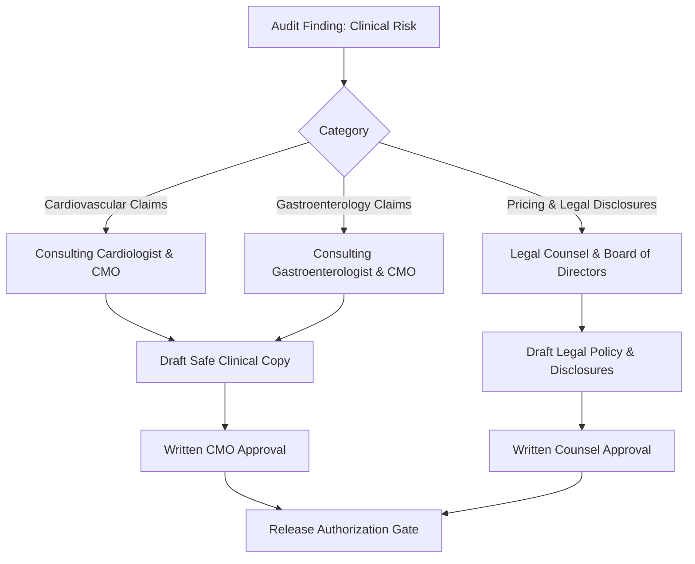

# OMShree Sidha Hospital — Clinical, Legal, and Patient Safety Risk Register
**Date:** October 15, 2026  
**Auditor:** Antigravity Clinical Governance & Healthcare Legal Practice  
**Classification:** STRICTLY RESTRICTED / CMO, CLINICAL HEADS & LEGAL COUNSEL  
**Statutory Framework:** Drugs and Magic Remedies (Objectionable Advertisements) Act 1954, National Medical Commission (NMC) Ethics Regulations 2002/2023, Consumer Protection Act 2019, AYUSH Ethical Guidelines  

---

## 1. Executive Notice to Hospital Leadership

> [!CAUTION]
> **CRITICAL MEDICAL GOVERNANCE WARNING**  
> This document audits patient-facing medical claims on the Omshree Sidha Hospital website. Multiple public statements advise patients to **discontinue life-saving conventional medications**, claim **reversal of 90–100% calcified cardiac plaques**, promise **unrestricted fluid intake in congestive heart failure**, and offer **money-back guaranteed cures**.
> 
> Under Indian law, conventional medical ethics, and standard clinical practice, these statements expose patients to **severe morbidity and mortality risk**, while exposing the hospital and its licensed physicians to **statutory criminal liability under the Drugs and Magic Remedies Act**, medical council license suspension, and civil liability under the Consumer Protection Act.
> 
> **No copy modifications may be published without written, documented sign-off from the Chief Medical Officer, consulting medical specialists, and qualified healthcare legal counsel.**

---

## 2. Clinical Safety & Medical Claims Register

### Item CR-01: Discontinuation of Allopathic Medications in Ulcerative Colitis
- **URL & Source:** `/treatments/ulcerative-colitis` | `src/data/treatments/ulcerative-colitis.json:15`
- **Existing Text:**
  > *"Usually we admit the patients for 4 weeks, rare cases it may take some more time. Once you start our treatment, we stop all other medicines that you are taking for Ulcerative colitis."*
- **Clinical Risk Analysis:**
  - Patients with Ulcerative Colitis (UC) frequently rely on mesalamine, systemic corticosteroids, immunomodulators (azathioprine), or biologics (anti-TNF agents).
  - Abrupt cessation of systemic corticosteroids precipitates acute adrenal crisis. Abrupt discontinuation of maintenance therapy risks severe acute flare, fulminant colitis, bowel perforation, and toxic megacolon requiring emergency colectomy.
- **Required Reviewer:** Chief Medical Officer (CMO) & Consulting Gastroenterologist.
- **Release-Blocking Status:** **P0 — RELEASE BLOCKER (URGENT REMEDIATION REQUIRED)**.
- **Recommended Remediation (Pending CMO Approval):** Completely delete the sentence *"Once you start our treatment, we stop all other medicines that you are taking for Ulcerative colitis."* Replace with: *"Our Ayurvedic protocols are designed to provide supportive care. Any changes to your existing prescribed medications must only be made under the direct supervision and written guidance of your treating physician/gastroenterologist."*

---

### Item CR-02: Discontinuation of Conventional Medications in Heart Disease
- **URL & Source:** `/treatments/heart-disease-and-blocks` | `src/data/treatments/heart-disease-and-blocks.json:12`
- **Existing Text:**
  > *"Once the blocks are removed, there is no need to continue the medicines. You just check your cholesterol, BP etc… occasionally and if it is high, just take the medicine for that only."*
- **Clinical Risk Analysis:**
  - Coronary artery disease patients depend on antiplatelet agents (aspirin, clopidogrel), statins, ACE inhibitors, and beta-blockers to prevent acute stent thrombosis, recurrent ischemia, and sudden cardiac death.
  - Advising heart patients that *"there is no need to continue the medicines"* creates an unacceptable risk of acute myocardial infarction.
- **Required Reviewer:** Chief Medical Officer (CMO) & Consulting Cardiologist.
- **Release-Blocking Status:** **P0 — RELEASE BLOCKER (URGENT REMEDIATION REQUIRED)**.
- **Recommended Remediation:** Completely expunge all claims of stopping cardiac medications. Emphasize that Ayurvedic therapies serve as complementary and supportive care alongside physician-managed pharmacotherapy.

---

### Item CR-03: Unrestricted Fluid Intake in Low Ejection Fraction & Heart Failure
- **URL & Source:** `/blog/what-is-ejection-fraction-and-what-does-it-tell-you-about-heart-function` | `src/app/blog/what-is-ejection-fraction.../page.tsx:181`
- **Existing Text:**
  > *"Freedom from Fluid Restrictions: As your heart's efficiency is fully restored, you will be able to drink plenty of water safely and comfortably without any daily limits."*
- **Clinical Risk Analysis:**
  - Fluid restriction (typically 1.5 to 2.0 liters/day) is a mandatory clinical cornerstone of congestive heart failure and low ejection fraction management to prevent hypervolemia.
  - Promising that patients can *"drink plenty of water safely and comfortably without any daily limits"* directly encourages heart failure decompensation, acute pulmonary edema, pleural effusion, and life-threatening respiratory failure.
- **Required Reviewer:** Consulting Cardiologist & CMO.
- **Release-Blocking Status:** **P0 — RELEASE BLOCKER (URGENT REMEDIATION REQUIRED)**.
- **Recommended Remediation:** Delete the statement immediately. Replace with an explicit clinical caution that fluid management must strictly adhere to the limits established by the patient's cardiologist.

---

### Item CR-04: Plaque Reversal & Melting 90–100% Arterial Blocks
- **URL & Source:** `/treatments/heart-disease-and-blocks` | `src/data/treatments/heart-disease-and-blocks.json:12`
- **Existing Text:**
  > *"We are the only one hospital in the world giving a money back guaranteed treatment for heart blocks. Within 3 to 6 months time blocks will gradually melt and disappear, rare cases it may take some more time. Even if there are multiple blocks, and most of them are in between 90% to 100%, our treatment will helps to remove all of these blocks in a short time."*
- **Clinical & Legal Risk Analysis:**
  - Atherosclerotic plaque reversal, especially calcified fibroatheromas causing 90–100% luminal stenosis, cannot be clinically promised or guaranteed by any known medical intervention in 3–6 months.
  - Directly violates the **Drugs and Magic Remedies (Objectionable Advertisements) Act 1954**, which explicitly prohibits advertisements claiming to cure or prevent heart diseases (Schedule Item 25).
- **Required Reviewer:** Healthcare Legal Counsel & Consulting Cardiologist.
- **Release-Blocking Status:** **P0 — RELEASE BLOCKER (STATUTORY VIOLATION)**.
- **Recommended Remediation:** Remove all references to "melting blocks", "90% to 100% block removal", and "money back guaranteed treatment". Describe Ayurvedic cardiac care strictly in terms of lifestyle modification, symptom improvement, lipid profile support, and holistic well-being.

---

### Item CR-05: 75% Cure & World-Exclusivity Claims in Crohn's Disease
- **URL & Source:** `/treatments/crohns-disease-inflammatory-bowel-disease-ibd` | `src/data/treatments/crohns-disease.json:12,15`
- **Existing Text:**
  > *"We are the only one hospital in the world, providing money back guaranteed treatment for Cohn’s disease. We will cure you in short time... Within 4 weeks, your condition will improve at least 75%. Usually patients will be cured in one to three months’ time."*
- **Clinical & Legal Risk Analysis:**
  - Crohn's disease is medically defined as a chronic, incurable relapsing inflammatory disorder.
  - Claiming a guaranteed cure in 1–3 months and promising a 75% improvement within 4 weeks constitutes false and misleading advertising under Section 2(28) of the Consumer Protection Act 2019.
- **Required Reviewer:** CMO & Consulting Gastroenterologist.
- **Release-Blocking Status:** **P0 — RELEASE BLOCKER**.
- **Recommended Remediation:** Eliminate numerical percentages, cure promises, and "only one hospital in the world" assertions.

---

### Item CR-06: Contingent Fee Billing & Bank Guarantees ("The Challenging Offer")
- **URL & Source:** `/patient-care/challenging-offer` | `src/app/patient-care/challenging-offer/page.tsx:48-60`
- **Existing Text:**
  > *"Bank Guarantee: Before starting, you must execute a bank guarantee equal to the estimated cost + 33%... Premium Charge: In cases where this offer is applied, we charge 25% extra... If you are symptomatically or as per test results, cured or improved considerably (at least 80% of the expected level of recovery), you must make the full payment... If your condition improves by 50%... you pay 50%."*
- **Clinical & Legal Risk Analysis:**
  - National Medical Commission (NMC) Code of Medical Ethics Regulation 6.6 explicitly forbids contingent fees where payment is contingent on the success of medical treatment.
  - Conditioning charges on subjective or test recovery percentages incentivizes disputes and regulatory complaints.
- **Required Reviewer:** Hospital Board of Directors & Senior Legal Counsel.
- **Release-Blocking Status:** **P0 — RELEASE BLOCKER**.
- **Recommended Remediation:** Withdraw the public "Challenging Offer" page from the sitemap and navigation. Replace with transparent, standard hospital tariffs and admissions policies.

---

### Item CR-07: Unverified Editorial Marker in Live Treatment Data
- **URL & Source:** `/treatments/heart-disease` | `src/data/treatments/heart-disease.json:37`
- **Existing Text:**
  > *"While complete reversal of structural damage is highly challenging, our treatments focus on halting disease progression, strengthening remaining healthy tissue, and significantly improving cardiac output and quality of life. [VERIFY BEFORE PUBLICATION]"*
- **Quality & Trust Impact:** Renders an internal editorial drafting instruction `[VERIFY BEFORE PUBLICATION]` on the public production page, degrading clinical trust and signaling unreviewed copy.
- **Required Reviewer:** Content Editorial Lead & CMO.
- **Release-Blocking Status:** **P1 — HIGH PRIORITY**.
- **Recommended Remediation:** Verify cardiomyopathy clinical claim with CMO, approve final phrasing, and remove bracketed marker.

---

## 3. Statutory & Regulatory Impact Matrix

| Legislation / Guideline | Specific Clause / Rule | Identified Website Defect | Potential Legal Penalty / Consequence |
| :--- | :--- | :--- | :--- |
| **Drugs and Magic Remedies (Objectionable Advertisements) Act 1954** | Section 3 & Schedule (Diseases/Conditions: Heart Diseases, Cancer) | Promising cure & melting of heart blocks (`heart-disease-and-blocks.json:12`) | Imprisonment up to 6 months (1st conviction) / 1 year (subsequent) and fines. |
| **NMC Ethics Regulations 2002 / 2023** | Regulation 6.1 (Advertising) & Regulation 6.6 (Contingent Fees) | "Only hospital in world"; "Money back guarantee"; "Challenging Offer" bank guarantees | Disciplinary inquiry and suspension of medical registration of responsible physicians. |
| **Consumer Protection Act 2019** | Section 2(28) & Section 89 (Misleading Advertisements) | Guaranteed 75% cure in Crohn's disease; 100% cure in Ulcerative Colitis | Penalty up to ₹10 Lakhs on manufacturer/endorser and prohibition of advertising. |
| **AYUSH Ministry Guidelines 2020** | Guidelines on Ethical Advertising of Ayurvedic Medicines | Promising total cure for chronic autoimmune and structural diseases | Revocation of hospital licensing / GMP license sanctions. |
| **Google Ads Healthcare Policy** | Speculative and Experimental Treatments & Misleading Claims | Guaranteed cure claims and unsubstantiated medical efficacy | Immediate suspension of Google Ads and Meta advertising accounts. |

---

## 4. Required Approver Matrix & Action Protocol

| Issue ID | Required Primary Approver | Required Secondary Approver | Approval Artifact Required |
| :--- | :--- | :--- | :--- |
| **CR-01 (UC Meds)** | Consulting Gastroenterologist | Chief Medical Officer (CMO) | Written clinical clearance memorandum |
| **CR-02 (Heart Meds)** | Consulting Cardiologist | Chief Medical Officer (CMO) | Written clinical clearance memorandum |
| **CR-03 (Fluid Restrictions)**| Consulting Cardiologist | Chief Medical Officer (CMO) | Written clinical clearance memorandum |
| **CR-04 (Heart Blocks)** | Healthcare Legal Counsel | Consulting Cardiologist | Statutory compliance clearance |
| **CR-05 (Crohn's Cure)** | Consulting Gastroenterologist | Chief Medical Officer (CMO) | Clinical clearance memorandum |
| **CR-06 (Challenging Offer)**| Senior Legal Counsel | Board of Directors | Board resolution withdrawing contingent scheme |
| **CR-07 (Editorial Tag)** | Content Lead | Chief Medical Officer (CMO) | Editorial verification sign-off |
