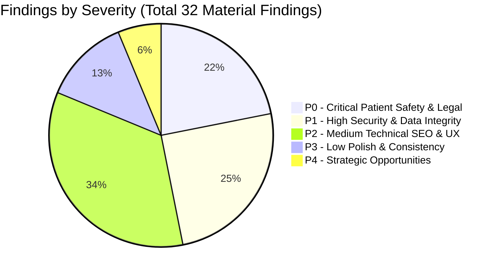
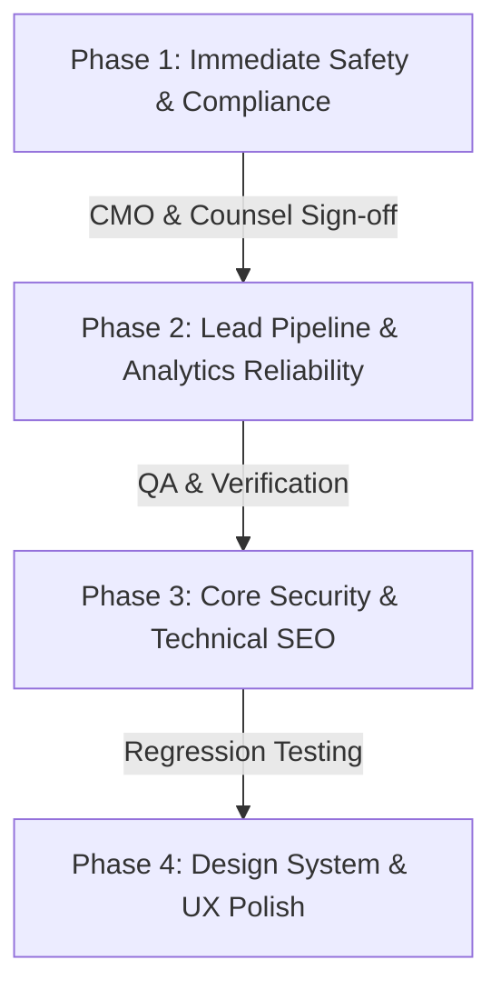

# OMShree Sidha Hospital — Executive Audit Summary
**Date:** October 15, 2026  
**Auditor:** Antigravity Multidisciplinary Engineering & Clinical Governance Taskforce  
**Target Website:** [https://omshreeayur.com](https://omshreeayur.com)  
**Repository Baseline:** `f1429da` on branch `main` (Clean working tree)  
**Audit Operating Mode:** Strictly Read-Only, Evidence-Based, No-Bluffing  
**Release Readiness Status:** **NO-GO FOR CAMPAIGNS / CONDITIONAL RESTRICTED**

---

## 1. Executive Status & Leadership Verdict

Omshree Sidha Hospital possesses a fast, modern Next.js 16 (Turbopack, App Router, React 19) front-end foundation that compiles cleanly and achieves rapid static generation (45 SSG routes in ~1.9s). However, our comprehensive multi-disciplinary audit has identified **immediate P0 patient-safety, legal compliance, and operational integrity risks** that prevent unrestricted public advertising and expose the hospital to statutory liability, reputation damage, and silent patient lead loss.

Until the P0 clinical claims, legal privacy deficiencies, and lead capture persistence defects are remediated under authorized medical and legal supervision, **the website cannot be considered release-ready for active digital marketing campaigns.**

---

## 2. Key Findings Summary by Category

| Category | Status | P0 | P1 | P2 | P3 | Primary Business / Patient Impact |
| :--- | :--- | :---: | :---: | :---: | :---: | :--- |
| **Clinical Governance & Safety** | **CRITICAL RISK** | 5 | 1 | 2 | 0 | Severe risk of patient harm (stopping heart/colitis meds; unrestricted fluid intake in heart failure). |
| **Legal & Advertising Compliance** | **NON-COMPLIANT** | 2 | 2 | 1 | 0 | Statutory violation of Drugs & Magic Remedies Act (cure & 100% block removal claims); Missing Privacy Policy (404). |
| **Lead Capture & Inquiries** | **DATA LOSS RISK** | 0 | 2 | 1 | 0 | Forms return success to patients even when email delivery fails; zero database persistence. |
| **Digital Analytics & Tracking** | **DEFECTIVE** | 0 | 2 | 1 | 0 | GA4 custom event tracking is dead in production due to an environment guard bug; marketing attribution blind. |
| **Application Security** | **VULNERABLE** | 0 | 3 | 2 | 0 | 23 vulnerabilities (2 Critical in Next.js core & proxy-addr); missing CSP and HSTS headers. |
| **Technical SEO & Indexing** | **NEEDS REPAIR** | 0 | 1 | 3 | 1 | Blog index omitted from sitemap; content cannibalization between EF blog and EF condition pages. |
| **UX & Accessibility** | **PARTIAL** | 0 | 0 | 4 | 2 | Broken 404 links in global footer (`/privacy-policy`, `/terms`); unescaped entities; contrast warnings. |
| **Performance & Build** | **STRONG** | 0 | 0 | 1 | 1 | Fast static generation; unoptimized legacy WordPress images hosted via external domains. |

---

## 3. Top 5 Immediate Patient Safety & Legal Risks (P0)

1. **Direct Instruction to Stop Allopathic Medicines (Ulcerative Colitis & Heart Disease):**
   - *Evidence:* `src/data/treatments/ulcerative-colitis.json:15` states: *"Once you start our treatment, we stop all other medicines that you are taking for Ulcerative colitis."*
   - *Evidence:* `src/data/treatments/heart-disease-and-blocks.json:12` states: *"Once the blocks are removed, there is no need to continue the medicines."*
   - *Clinical Impact:* Abrupt discontinuation of immunosuppressants, corticosteroids, beta-blockers, statins, or antiplatelet therapy risks acute toxic megacolon or fatal myocardial infarction.

2. **Unrestricted Fluid Intake Advice in Low Ejection Fraction / Heart Failure:**
   - *Evidence:* `src/app/blog/what-is-ejection-fraction-and-what-does-it-tell-you-about-heart-function/page.tsx:181` states: *"Freedom from Fluid Restrictions: As your heart's efficiency is fully restored, you will be able to drink plenty of water safely and comfortably without any daily limits."*
   - *Clinical Impact:* Patients with congestive heart failure and reduced EF who consume unrestricted water face immediate risk of acute pulmonary edema, cardiac decompensation, and emergency hospitalization.

3. **Statutory Violations of Drugs and Magic Remedies (Objectionable Advertisements) Act 1954:**
   - *Evidence:* `src/data/treatments/heart-disease-and-blocks.json:12` (*"Within 3 to 6 months time blocks will gradually melt and disappear... Even if there are multiple blocks, and most of them are in between 90% to 100%"*), `crohns-disease.json:12` (*"We are the only one hospital in the world, providing money back guaranteed treatment for Cohn’s disease. We will cure you in short time."*).
   - *Legal Impact:* Heart diseases and chronic conditions are listed under the Schedule to the Drugs and Magic Remedies Act. Claiming guarantees, cures, or melting 90-100% calcified plaques carries severe regulatory penalties, licensing suspension, and immediate rejection of Google Ads / Meta Ads accounts.

4. **Results-Based Contingent Financial Billing ("The Challenging Offer"):**
   - *Evidence:* `src/app/patient-care/challenging-offer/page.tsx:50-57` establishes contingent pricing requiring a bank guarantee equal to estimated cost + 33%, a 25% premium surcharge, and payment scaled to 50% or 80% recovery percentages.
   - *Governance Impact:* Direct conflict with National Medical Commission (NMC) Registered Medical Practitioner Regulations prohibiting contingent fee arrangements and fee splitting.

5. **Global Footer Legal Links Returning HTTP 404 (Privacy Policy & Terms):**
   - *Evidence:* `src/components/layout/Footer.tsx:94-95` links to `/privacy-policy` and `/terms`. Both return HTTP 404 on live crawl.
   - *Compliance Impact:* Violates the Digital Personal Data Protection Act (DPDP Act 2023) and Information Technology (Reasonable Security Practices) Rules, 2011 Rule 4.

---

## 4. Top 3 Operational & Technical Defects (P1)

1. **Silent Patient Lead Loss in Inquiries API:**
   - *Evidence:* `src/app/api/enquiry/route.ts:50-70`. When `RESEND_API_KEY` is missing or fails, the API logs to `console.error` and returns `{ success: true, leadId: 'LEAD-...' }` to the user.
   - *Business Impact:* Inpatients inquiring about expensive hospital stays receive a success screen while hospital staff never receive the notification. Zero database persistence exists to recover missed leads.

2. **Google Analytics 4 Custom Event Pipeline Inoperative:**
   - *Evidence:* `src/lib/analytics.ts:30` guards event firing with `if (window.gtag && process.env.NEXT_PUBLIC_GA_ID)`. Because `NEXT_PUBLIC_GA_ID` is omitted from client environment builds, `trackEvent` silently no-ops.
   - *Business Impact:* Zero conversion events (consultation clicks, WhatsApp clicks, phone calls, form submissions) are recorded in GA4.

3. **High-Severity Core Dependency Vulnerabilities:**
   - *Evidence:* `npm audit` reveals 23 vulnerabilities (2 Critical in `next@16.2.12` and `proxy-addr`, 17 High).
   - *Security Impact:* Remote attackers could leverage known request-smuggling or SSRF vectors in unpatched Next.js server runtimes.

---

## 5. Phased Remediation Strategy & Next Steps

- **Phase 1 (Week 1 — Critical Safety Gate):** Remove all medication-stopping copy, remove unrestricted fluid claims, suppress "Challenging Offer" and money-back guarantees, implement compliant `/privacy-policy` and `/terms-and-conditions` redirects.
- **Phase 2 (Week 2 — Lead Capture & Measurement):** Add Supabase/PostgreSQL persistent storage to `/api/enquiry` with failover email logging; fix GA4 client event dispatch.
- **Phase 3 (Week 3 — Security & Architecture):** Patch Next.js to stable audited patch release, enforce strict CSP and HSTS headers, fix sitemap omissions.
- **Phase 4 (Week 4 — UX & Content Architecture):** Resolve content cannibalization between EF blog and EF condition page, fix unescaped entities, optimize external legacy images.

---

## 6. Audit Governance & Verification

- **Repository Integrity:** Confirmed 100% read-only throughout inspection. No application files modified.
- **Git Commit:** Current commit `f1429da` remains untouched.
- **Production Status:** No commits, pushes, or deployments were performed.
