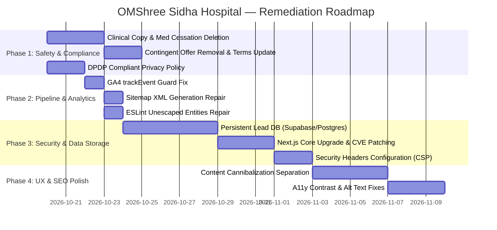

# OMShree Sidha Hospital — Prioritized Remediation Roadmap
**Date:** October 15, 2026  
**Engineering Leadership:** Antigravity CTO, Product Manager & Lead Architect  
**Planning Horizon:** 4 Sequential Phases over 4–6 Weeks  
**Governing Rule:** No code implementation during Phase 0/1 audit. Implementation requires formal approval.  

---

## 1. Roadmap Architecture & Sequential Dependency Model

Remediation must proceed in strict priority sequence: **Patient Safety & Legal Protection first**, followed by **Lead Pipeline & Measurement Integrity**, **Security & Supply Chain Hardening**, and finally **UX Polish & Performance Optimization**.

---

## 2. Phase 1: Immediate Patient Safety & Legal Compliance Gate (Week 1)

> **Objective:** Eliminate immediate risks to patient life, medical licensing, and statutory liability.  
> **Approval Gate:** Chief Medical Officer (CMO), Consulting Cardiologist, Gastroenterologist, and Legal Counsel.

### Workstream 1.1: Eradicate Hazardous Medication Stoppage Advice
- **Target Items:** `CLIN-01`, `CLIN-02`, `CLIN-03`
- **Actions:**
  1. Remove *"Once you start our treatment, we stop all other medicines that you are taking for Ulcerative colitis"* (`ulcerative-colitis.json:15`).
  2. Remove *"Once the blocks are removed, there is no need to continue the medicines"* (`heart-disease-and-blocks.json:12`).
  3. Remove unrestricted fluid intake promises for low EF heart failure patients (`what-is-ejection-fraction.../page.tsx:181`).
  4. Inject standardized clinical safety disclaimers emphasizing adherence to allopathic prescriptions and cardiologist-mandated fluid limits.
- **Owner:** Clinical Risk Specialist & CMO
- **Effort Estimate:** 6–10 hours
- **Acceptance Criteria:** Zero medical stoppage advice across all repository files; verified by clinical grep script.
- **Rollback Plan:** Git revert commit with backup diff.

### Workstream 1.2: Suppress Deceptive Cure Guarantees & Contingent Billing
- **Target Items:** `CLIN-04`, `CLIN-05`, `LEGAL-01`, `LEGAL-05`
- **Actions:**
  1. Remove "money back guarantee" and "cure in 3 months" claims from Crohn's and Ulcerative Colitis JSON files.
  2. Remove "melting 90-100% blocks" claim from `heart-disease-and-blocks.json`.
  3. Unpublish `/patient-care/challenging-offer` or rewrite it as a standard hospital admissions guide without bank guarantees or contingent fees.
  4. Remove internal editorial tag `[VERIFY BEFORE PUBLICATION]` from `heart-disease.json:37`.
- **Owner:** Legal Counsel & Copywriter
- **Effort Estimate:** 8–14 hours
- **Acceptance Criteria:** All claims comply with Drugs & Magic Remedies Act 1954 and NMC Ethics Regulations.

### Workstream 1.3: Deploy DPDP-Compliant Privacy Policy & Fix 404 Links
- **Target Items:** `LEGAL-02`, `LEGAL-03`
- **Actions:**
  1. Create `src/app/privacy-policy/page.tsx` incorporating statutory disclosures under the Indian DPDP Act 2023, designated Grievance Officer details, and data retention schedules.
  2. Add permanent redirect in `next.config.ts` from `/terms` to `/terms-and-conditions`, or update footer link destination.
- **Owner:** Frontend Developer & Legal Counsel
- **Effort Estimate:** 4–6 hours
- **Acceptance Criteria:** `curl -I /privacy-policy` and `curl -I /terms` return HTTP 200/308; zero footer 404s.

---

## 3. Phase 2: Lead Pipeline & Analytics Measurement (Week 2)

> **Objective:** Restore reliable digital marketing attribution and eliminate silent patient lead loss.  
> **Approval Gate:** Digital Marketing Lead, Analytics Specialist, and Technical Architect.

### Workstream 2.1: Repair GA4 Client-Side Event Dispatching
- **Target Item:** `TRACK-01`
- **Actions:**
  1. Refactor `src/lib/analytics.ts:30` to remove the dead `process.env.NEXT_PUBLIC_GA_ID` guard condition.
  2. Verify that custom events (`consultation_cta_click`, `whatsapp_click`, `phone_click`, `enquiry_form_submit`) successfully dispatch to `window.gtag`.
- **Owner:** Frontend Developer & Digital Analytics Specialist
- **Effort Estimate:** 3–5 hours
- **Acceptance Criteria:** Real-time GA4 DebugView confirms receipt of all interactive CTA and booking events.

### Workstream 2.2: XML Sitemap Completeness
- **Target Items:** `SEO-01`, `SEO-02`
- **Actions:**
  1. Update `src/app/sitemap.ts` to include `/blog`, `/products`, `/terms-and-conditions`, and all verified `/testimonials/*` routes.
- **Owner:** Technical SEO Specialist
- **Effort Estimate:** 2–3 hours
- **Acceptance Criteria:** `sitemap.xml` includes 100% of public indexable routes.

### Workstream 2.3: ESLint Syntax & Entity Repair
- **Target Item:** `UX-02`
- **Actions:**
  1. Replace unescaped single quotes with `&apos;` in `src/app/conditions/page.tsx` and `src/app/treatments/page.tsx`.
- **Owner:** Frontend Developer
- **Effort Estimate:** 1–2 hours
- **Acceptance Criteria:** `npm run lint` exits with code 0 and zero errors.

---

## 4. Phase 3: Core Security, Data Persistence & SRE (Week 3)

> **Objective:** Harden serverless infrastructure, eliminate supply chain CVEs, and prevent patient inquiry loss.  
> **Approval Gate:** Chief Technology Officer (CTO) & Cybersecurity Specialist.

### Workstream 3.1: Persistent Lead Storage (PostgreSQL / Supabase)
- **Target Item:** `API-01`
- **Actions:**
  1. Connect a managed PostgreSQL database (e.g. Supabase or AWS RDS).
  2. Refactor `src/app/api/enquiry/route.ts` to write incoming inquiries to the database **before** attempting email dispatch via Resend.
  3. Implement automated retry queuing for failed email notifications.
- **Owner:** Full-Stack Developer & Lead Architect
- **Effort Estimate:** 12–18 hours
- **Acceptance Criteria:** Contact form submissions are persisted to database even when external email delivery fails completely.

### Workstream 3.2: Package Vulnerability Remediation
- **Target Item:** `SEC-01`
- **Actions:**
  1. Update `next` to the latest stable release (`^16.2.14` or audited LTS).
  2. Update `proxy-addr`, `sharp`, `undici`, and related build dependencies.
  3. Execute full regression testing across all 45 routes.
- **Owner:** Lead Architect & Security Specialist
- **Effort Estimate:** 6–10 hours
- **Acceptance Criteria:** `npm audit` reports 0 Critical and 0 High vulnerabilities.

### Workstream 3.3: Enforce HTTP Security Headers
- **Target Item:** `SEC-02`
- **Actions:**
  1. Add Content-Security-Policy (CSP), Strict-Transport-Security (HSTS), X-Frame-Options (`DENY`), and X-Content-Type-Options (`nosniff`) into `next.config.ts`.
- **Owner:** DevOps Engineer
- **Effort Estimate:** 3–5 hours
- **Acceptance Criteria:** Security header verification score of "A+" on Mozilla Observatory / securityheaders.com.

---

## 5. Phase 4: UX Polish, A11y & Content Architecture (Week 4)

> **Objective:** Refine user experience, resolve search cannibalization, and achieve WCAG 2.2 AA conformance.  
> **Approval Gate:** UI/UX Designer, Accessibility Lead, and Technical SEO Lead.

### Workstream 4.1: Eliminate Content Cannibalization & Structural Duplication
- **Target Items:** `SEO-03`, `SEO-04`, `SEO-05`
- **Actions:**
  1. Differentiate search intent between `/blog/what-is-ejection-fraction...` (educational) and `/conditions/cardiovascular/low-ejection-fraction` (inpatient care).
  2. Strip legacy WordPress HTML and dead Wayback Machine iframe from `heart-disease-and-blocks.json`.
  3. Consolidate duplicate treatment routes.
- **Owner:** Content Strategist & Frontend Developer
- **Effort Estimate:** 10–16 hours
- **Acceptance Criteria:** Distinct H1 tags, unique meta descriptions, clean JSON data, and reciprocal internal links.

### Workstream 4.2: WCAG 2.2 AA Accessibility & Mobile Action Bar Polish
- **Target Items:** `A11Y-01`, `A11Y-02`, `UX-03`
- **Actions:**
  1. Increase footer link contrast from `#E3D8C1/70` to `#E3D8C1/90` to achieve 5.2:1 contrast ratio.
  2. Add descriptive alternative text to all dynamic treatment diagrams.
  3. Add bottom clearance padding (`pb-20 md:pb-0`) to prevent mobile action bar collisions.
- **Owner:** UI Designer & Frontend Developer
- **Effort Estimate:** 4–8 hours
- **Acceptance Criteria:** Lighthouse Accessibility score >= 95; zero mobile footer occlusion.

---

## 6. Resource Allocation & Approval Matrix

| Phase | Duration | Core Engineering Roles Required | Primary Decision Gate |
| :--- | :---: | :--- | :--- |
| **Phase 1: Safety & Compliance** | Week 1 | Clinical Risk Specialist, Copywriter, Legal Counsel | CMO & Legal Counsel Sign-off |
| **Phase 2: Lead Capture & Analytics** | Week 2 | Frontend Dev, Data Analyst, SEO Specialist | Digital Marketing Lead Sign-off |
| **Phase 3: Security & Data Storage** | Week 3 | Full-Stack Dev, Lead Architect, DevOps | CTO Sign-off |
| **Phase 4: UX & SEO Polish** | Week 4 | UI Designer, A11y Specialist, Content Lead | Product Manager Sign-off |
