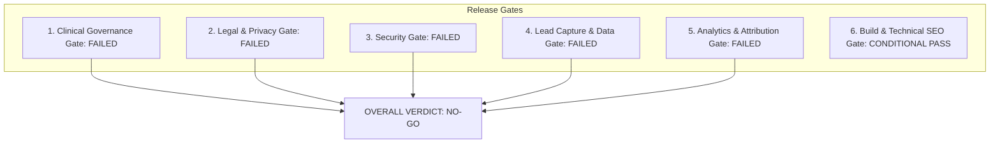

# OMShree Sidha Hospital — Release Readiness Checklist & Go/No-Go Gate
**Audit Date:** October 15, 2026  
**Auditor:** Antigravity CTO & Multidisciplinary Taskforce  
**Target Domain:** [https://omshreeayur.com](https://omshreeayur.com)  
**Overall Status:** **NO-GO FOR CAMPAIGNS / RELEASE BLOCKED**  

---

## 1. Executive Go/No-Go Decision Dashboard

> **LEADERSHIP VERDICT: NO-GO FOR AD CAMPAIGNS & UNRESTRICTED PUBLIC PROMOTION**  
> While the Next.js static build compiles cleanly, the website fails 5 out of 6 critical operational release gates. Running Google Ads or Meta Ads in the current state exposes the hospital to immediate regulatory sanctions under the Drugs & Magic Remedies Act, potential medical council inquiry for dangerous clinical advice (stopping allopathic heart/UC meds), statutory penalties under the DPDP Act 2023 for a missing privacy policy (404), and total advertising waste due to broken GA4 conversion tracking and silent lead loss in the contact form.

---

## 2. Gate-by-Gate Verification Matrix

### Gate 1: Clinical Governance & Patient Safety Gate
**Status: FAILED (RELEASE BLOCKER)**  
**Responsible Sign-off:** Chief Medical Officer (CMO), Consulting Cardiologist & Gastroenterologist

| Check Item | Requirement | Observed Status | Gate Result |
| :--- | :--- | :--- | :---: |
| **CG-01** | Zero advice encouraging patients to discontinue prescribed allopathic medications. | Advises stopping all UC medications (`ulcerative-colitis.json:15`) and heart medications (`heart-disease-and-blocks.json:12`). | **FAIL** |
| **CG-02** | Zero unrestricted fluid recommendations for congestive heart failure / low EF patients. | States patients can drink water "without any daily limits" (`what-is-ejection-fraction.../page.tsx:181`). | **FAIL** |
| **CG-03** | Zero unsubstantiated percentage cure guarantees or "only hospital in the world" claims. | Claims 75% cure in 4 weeks for Crohn's (`crohns-disease.json:12,15`). | **FAIL** |
| **CG-04** | Zero claims of melting 90-100% calcified arterial blocks in 3-6 months. | Claims blocks will "gradually melt and disappear" (`heart-disease-and-blocks.json:12`). | **FAIL** |
| **CG-05** | Complete removal of all internal editorial verification markers from public pages. | Live JSON displays `"[VERIFY BEFORE PUBLICATION]"` (`heart-disease.json:37`). | **FAIL** |

---

### Gate 2: Legal, Regulatory & Privacy Gate
**Status: FAILED (RELEASE BLOCKER)**  
**Responsible Sign-off:** Healthcare Legal Counsel & Board of Directors

| Check Item | Requirement | Observed Status | Gate Result |
| :--- | :--- | :--- | :---: |
| **LR-01** | Statutory compliance with Drugs and Magic Remedies (Objectionable Advertisements) Act 1954. | Unlawful claims of curing and melting blocks for scheduled heart disease. | **FAIL** |
| **LR-02** | Compliance with NMC Ethics Regulations (Prohibition of contingent billing and guarantees). | Contingent fee structure with 33% bank guarantee on `/patient-care/challenging-offer`. | **FAIL** |
| **LR-03** | DPDP Act 2023 compliant Privacy Policy accessible on all public pages. | Footer link `/privacy-policy` returns HTTP 404 Not Found. | **FAIL** |
| **LR-04** | Valid Terms of Service accessible without broken links. | Footer link `/terms` returns HTTP 404 Not Found. | **FAIL** |
| **LR-05** | Designated Grievance Officer details published with physical address and contact email. | Absent from website. | **FAIL** |

---

### Gate 3: Application Security & Supply Chain Gate
**Status: FAILED (HIGH RISK)**  
**Responsible Sign-off:** Chief Technology Officer (CTO) & Security Specialist

| Check Item | Requirement | Observed Status | Gate Result |
| :--- | :--- | :--- | :---: |
| **SEC-01** | Zero Critical and High severity dependency vulnerabilities in `npm audit`. | 23 vulnerabilities found (2 Critical in `next` and `proxy-addr`, 17 High). | **FAIL** |
| **SEC-02** | Zero plaintext secrets or API tokens in repository configuration. | GitHub Personal Access Token stored in plaintext in `.git/config`. | **FAIL** |
| **SEC-03** | Essential HTTP security headers enforced (HSTS, CSP, X-Frame-Options). | Missing from `next.config.ts`. | **FAIL** |
| **SEC-04** | Distributed abuse and rate-limiting protection on public submission endpoints. | Relies on ephemeral in-memory Map that resets across serverless containers. | **FAIL** |

---

### Gate 4: Lead Capture & Data Pipeline Gate
**Status: FAILED (HIGH REVENUE RISK)**  
**Responsible Sign-off:** Lead Architect & Head of Patient Inquiries

| Check Item | Requirement | Observed Status | Gate Result |
| :--- | :--- | :--- | :---: |
| **LC-01** | Persistent database storage for all patient contact and consultation inquiries. | Zero database connected; inquiries rely solely on ephemeral email dispatch. | **FAIL** |
| **LC-02** | Failover error handling preventing false success messages when delivery fails. | API logs error and returns `success: true` to the patient; lead permanently lost. | **FAIL** |
| **LC-03** | Automated notification alerts to hospital admissions staff upon lead capture. | Blocked if `RESEND_API_KEY` is invalid or third-party quota is exceeded. | **FAIL** |

---

### Gate 5: Analytics & Digital Marketing Attribution Gate
**Status: FAILED (HIGH MARKETING RISK)**  
**Responsible Sign-off:** Digital Analytics Lead & Performance Marketing Lead

| Check Item | Requirement | Observed Status | Gate Result |
| :--- | :--- | :--- | :---: |
| **TR-01** | Google Analytics 4 custom event tracking operational for all CTA clicks. | `trackEvent` silently no-ops because `NEXT_PUBLIC_GA_ID` is unset. | **FAIL** |
| **TR-02** | Conversion events firing correctly for WhatsApp, telephone, and form submissions. | Dead client-side execution; 0 conversion events recorded in GA4. | **FAIL** |
| **TR-03** | Google Consent Mode v2 implementation with explicit cookie banner controls. | Absent; scripts fire unconditionally on page load. | **FAIL** |

---

### Gate 6: Build Integrity & Technical SEO Gate
**Status: CONDITIONAL PASS**  
**Responsible Sign-off:** Front-End Lead & Technical SEO Specialist

| Check Item | Requirement | Observed Status | Gate Result |
| :--- | :--- | :--- | :---: |
| **TS-01** | TypeScript compilation succeeds without errors (`tsc --noEmit`). | Exit code 0, 0 compilation errors. | **PASS** |
| **TS-02** | Next.js production build succeeds with all routes prerendered. | 45/45 static routes compiled cleanly in 1.89s via Turbopack. | **PASS** |
| **TS-03** | ESLint static analysis passes without errors (`npm run lint`). | 4 errors (react/no-unescaped-entities) in conditions and treatments. | **FAIL** |
| **TS-04** | XML Sitemap includes all public indexable routes. | `/blog`, `/products`, `/terms-and-conditions`, `/testimonials` omitted. | **FAIL** |
| **TS-05** | Robots.txt directives valid and properly linked to sitemap. | Compliant; blocks `/api/` and `/_next/`. | **PASS** |

---

## 3. Explicit Conditions for Granting "GO" Status

To transition the website to **GO (APPROVED FOR RELEASE & PAID MARKETING)**, the hospital must complete the following minimum mandatory remediation actions:

1. **CMO Written Clearance:** Remove all medication discontinuation copy and unrestricted fluid advice.
2. **Legal Clearance:** Unpublish "The Challenging Offer" contingent billing page; remove "melting blocks" and "money-back guarantee" claims.
3. **Deploy Privacy Policy:** Launch a DPDP-compliant `/privacy-policy` page and fix `/terms` redirect.
4. **Fix Analytics Pipeline:** Remove the dead environment guard in `src/lib/analytics.ts` so conversion events fire to GA4.
5. **Protect Patient Inquiries:** Add database persistence (Supabase/PostgreSQL) to `/api/enquiry` to prevent silent lead loss.
6. **Patch Dependencies:** Update Next.js to eliminate Critical CVEs and rotate the exposed GitHub PAT.
