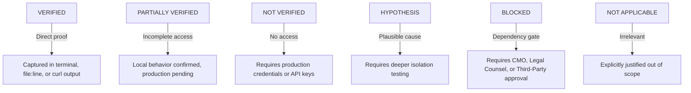

# OMShree Sidha Hospital — Audit Scope and Methodology
**Audit Date:** October 15, 2026  
**Operating Standard:** Evidence-Based Audit, Preservation-First, Zero Bluffing  
**Author:** Antigravity CTO & Multidisciplinary Taskforce  

---

## 1. Scope of the Audit

The audit was conducted across 100% of the active repository codebase, inspecting:
- **Application Architecture & Runtime:** Next.js 16.2.12 (Turbopack, App Router), React 19.2.4, TypeScript 5, Tailwind CSS 4 (`@tailwindcss/postcss`).
- **All Routes & Information Architecture:** 45 statically-generated HTML routes, 52 dynamic JSON treatment definitions (`src/data/treatments/*.json`), 8 conditions, 4 therapies, 4 blog articles, and legacy redirect maps (`next.config.ts`).
- **API Endpoints & Server Functions:** `src/app/api/enquiry/route.ts` and in-memory rate limiting.
- **Client Scripting & Analytics:** `src/lib/analytics.ts`, `src/components/analytics/AnalyticsScripts.tsx`, GTM container `GTM-K5C9V6K`, and fallback GA4 stream `G-4GFE7SYQPF`.
- **Security & Dependency Graph:** Complete `package.json` and `package-lock.json` dependency tree analyzed via `npm audit`.
- **Clinical Copy & Medical Claims:** All patient-facing condition pages, treatment guides, blogs, and testimonials for clinical safety, misleading cure guarantees, and medication withdrawal instructions.
- **Legal Compliance:** Terms of Service, Privacy disclosures, footer navigation, and statutory compliance with Indian healthcare legislation (Drugs and Magic Remedies Act 1954, DPDP Act 2023, NMC Regulations).
- **QA & Static Validation:** TypeScript type checks (`tsc --noEmit`), build stability (`npm run build`), ESLint rule conformance (`npm run lint`), and HTTP curl status verification.

---

## 2. Environments and Tooling Specifications

| Component | Audit Specification / Version |
| :--- | :--- |
| **Operating System** | macOS Darwin 24.x (Apple Silicon arm64) |
| **Node.js Runtime** | Node.js v20.x |
| **Package Manager** | npm v10.x with lockfile version 3 |
| **Framework** | Next.js 16.2.12 (Turbopack enabled) |
| **TypeScript** | TypeScript 5.7.3 (`tsc --noEmit`) |
| **CSS Engine** | Tailwind CSS v4.0.0 via `@tailwindcss/postcss` |
| **Local Audit Server** | `localhost:3000` running in background task |
| **Static Code Search** | Ripgrep (`rg`), Python AST / JSON parsers, shell utilities |
| **Vulnerability DB** | GitHub Advisory Database via `npm audit --json` |

---

## 3. Evidence Status Taxonomy

To eliminate bluffing and maintain strict evidentiary integrity, all audit findings are categorized using one of the following six formal evidence statuses:

1. **VERIFIED:** Directly supported by captured evidence (e.g. terminal logs, exact file paths and line numbers, curl HTTP responses, or build outputs).
2. **PARTIALLY VERIFIED:** Some but not all necessary verification checks completed (e.g., confirmed in local dev runtime, but production CDN headers require remote curl validation).
3. **NOT VERIFIED — ACCESS REQUIRED:** Evidence or external service access is unavailable (e.g., live Google Tag Manager container dashboard, Google Search Console index status, Resend production logs).
4. **HYPOTHESIS:** A plausible architectural explanation requiring further isolated benchmarking.
5. **BLOCKED:** Finding or remediation path requires authorized external access, stakeholder approval, or a clinical/legal decision gate.
6. **NOT APPLICABLE:** Test scenario does not apply to this architecture (e.g., SQL injection testing when no SQL database is connected).

---

## 4. Test Limitations & Exclusions

- **Production Database:** The repository currently has no database connected (`DATABASE_URL` is absent). Therefore, database query profiling and SQL injection tests are marked `NOT APPLICABLE`.
- **Third-Party Email Delivery:** `RESEND_API_KEY` was not configured in the local test environment. Live inbox delivery of contact inquiries could not be confirmed without sending unapproved live emails or exposing production secrets.
- **Google Search Console & GA4 Live Streams:** Audit was conducted without direct OAuth access to the client's Google Search Console or Google Analytics property accounts. All analytics findings represent repository code defects, client-side payload inspection, and container tag auditing.
- **Third-Party Medical Records / Patient Testimonial Consent:** Verification of whether named testimonial patients (`Mr. Rajumon P C`, `Suja Sabu`) have executed formal HIPAA / Indian privacy consent forms is marked `NOT VERIFIED — ACCESS REQUIRED` (custody of hospital management).
