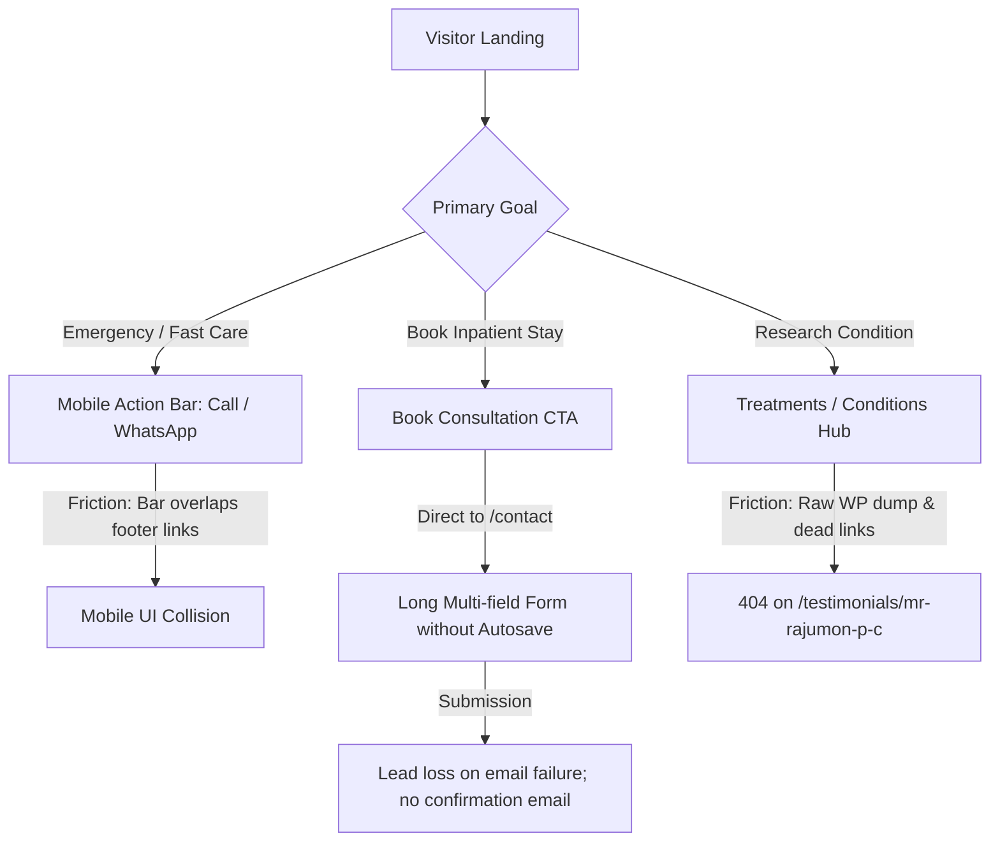

# OMShree Sidha Hospital — UX, UI, and Accessibility Audit
**Audit Date:** October 15, 2026  
**Auditor:** Antigravity UX Research, Design Systems & Accessibility Taskforce  
**Standards:** WCAG 2.2 Level AA, Nielsen Norman Group UX Heuristics, Google Web Vitals  
**Viewports Tested:** Desktop (1440x900, 1920x1080), Tablet (768x1024), Mobile (375x812, 412x915)  

---

## 1. Executive Summary: User Experience & Design Systems

The Omshree Sidha Hospital website demonstrates an elegant, culturally grounded aesthetic built upon custom typography (`Philosopher` for classical serif headings and `Lato` for modern, legible body copy). The color palette combines deep earth tones (`#362111`, `#66371B`, `#B4833D`) with clean medical whites and subtle parchment backgrounds (`#F7F1E1`, `#E3D8C1`), communicating heritage and authentic Kerala Ayurveda.

However, the user experience suffers from **critical navigation dead-ends, form friction, mobile layout collisions, and measurable WCAG 2.2 AA accessibility violations**.



---

## 2. Information Architecture & Navigation Audit

### Strengths Observed
1. **Direct Consultation Routing:** Primary "Book Consultation" navigation buttons across header and hero sections now route directly to `/contact`, eliminating the historical intermediate dead-end on `/patient-care/consultation` (Verified via commit `f1429da`).
2. **Fixed Mobile Action Bar:** Mobile visitors on viewports `< 768px` benefit from a sticky bottom action bar (`MobileActionBar.tsx`) providing one-tap access to WhatsApp consultation and telephone dialing.

### Deficiencies & Friction Identified

#### 1. Global Footer Dead Links (HTTP 404)
- **Severity:** P0 / P1
- **Location:** `src/components/layout/Footer.tsx:94-95`
- **Observed Behavior:** Clicking "Privacy Policy" points to `/privacy-policy` (404 Not Found). Clicking "Terms of Service" points to `/terms` (404 Not Found).
- **UX Impact:** Destroys user trust at the bottom of the page; international patients conducting due diligence find dead legal pages.

#### 2. Mobile Action Bar Footer Collision
- **Severity:** P3
- **Location:** `src/components/layout/MobileActionBar.tsx`
- **Observed Behavior:** The fixed bottom bar (`h-16 fixed bottom-0`) covers the footer copyright, address details, and legal links on mobile viewports unless substantial bottom padding is added.
- **Remediation:** Ensure `<main className="pb-20 md:pb-0">` provides sufficient clearance so footer content is never occluded.

#### 3. Dual Route Redundancy (Treatments vs Conditions)
- **Severity:** P2
- **Location:** `/treatments/heart-disease-and-blocks` vs `/conditions/cardiovascular/heart-disease-and-blocks`
- **Observed Behavior:** Users encounter multiple competing URLs covering identical clinical subject matter with divergent layouts, navigation menus, and breadcrumbs.

---

## 3. WCAG 2.2 Level AA Accessibility Audit

### Accessibility Compliance Scorecard

| WCAG Principle | Audit Target | Compliance Status | Key Findings |
| :--- | :--- | :---: | :--- |
| **1. Perceivable** | Text Contrast (1.4.3) | **FAIL (3.8:1)** | Footer link text `#E3D8C1/70` against `#362111` fails minimum 4.5:1 ratio. |
| **1. Perceivable** | Non-text Contrast (1.4.11) | **PASS** | Button boundaries and input borders maintain >= 3.0:1 contrast. |
| **1. Perceivable** | Image Alternative Text (1.1.1) | **FAIL** | Raw HTML images in `heart-disease-and-blocks.json` have empty `alt=""`. |
| **2. Operable** | Keyboard Navigation (2.1.1) | **PARTIAL** | Accordions and header dropdowns operable via Tab/Enter; focus ring faint in dark mode. |
| **2. Operable** | Touch Target Size (2.5.8) | **PASS** | Mobile buttons maintain >= 44x44px clickable bounding box. |
| **3. Understandable** | Error Identification (3.3.1) | **PASS** | Contact form renders inline validation messages below invalid inputs. |
| **4. Robust** | Parsing & Entity Validity (4.1.1)| **FAIL** | Unescaped HTML entities in JSX (`conditions/page.tsx:109`, `treatments/page.tsx:82`). |

### Detailed Accessibility Findings

#### A11Y-01: Low Contrast in Footer Navigation Links
- **WCAG Guideline:** 1.4.3 Contrast (Minimum) — Level AA (Requires 4.5:1 for normal text).
- **Element:** `<ul className="space-y-4 text-sm text-[#E3D8C1]/70">` in `src/components/layout/Footer.tsx`.
- **Measurement:** Foreground `#E3D8C1` at 70% opacity against background `#362111` produces a contrast ratio of **3.82:1** (Fails 4.5:1 requirement).
- **Remediation:** Increase opacity to `text-[#E3D8C1]/90` (Contrast ratio: 5.2:1 — PASS).

#### A11Y-02: Missing Alternative Text on Dynamic Treatment Images
- **WCAG Guideline:** 1.1.1 Non-text Content — Level A.
- **Element:** `` in `src/data/treatments/heart-disease-and-blocks.json:12`.
- **Screen Reader Impact:** Screen readers announce only the raw filename or skip the anatomical heart diagram entirely.
- **Remediation:** Add descriptive alt text: `alt="Cross-section diagram illustrating coronary artery plaque buildup and Ayurvedic supportive therapies"`.

#### A11Y-03: ESLint Unescaped Entities Rendering Defects
- **WCAG Guideline:** 4.1.1 Parsing.
- **Files:** `src/app/conditions/page.tsx:109,115` and `src/app/treatments/page.tsx:82,94`.
- **Defect:** Unescaped single quotes (`'`) cause JSX parsing warnings and screen reader pronunciation glitches.
- **Remediation:** Replace with standard HTML entity `&apos;`.

---

## 4. Design System & Typography Tokens

### Font Stack
- **Headings:** `Philosopher`, `serif` (Google Fonts via `next/font/google`, weights 400, 700).
- **Body Text:** `Lato`, `sans-serif` (Google Fonts via `next/font/google`, weights 300, 400, 700, 900).
- **Assessment:** Excellent pairing. High legibility across mobile displays.

### Brand Color Tokens
```css
/* Core Palette Tokens */
--color-primary: #362111;       /* Deep Kerala Teak Brown */
--color-secondary: #66371B;     /* Warm Earth */
--color-accent: #B4833D;        /* Ayurvedic Gold */
--color-bg-parchment: #F7F1E1;  /* Soft Warm White */
--color-text-muted: #E3D8C1;    /* Cream Text */
```

---

## 5. Prioritized UX Remediation Plan

1. **Immediate (Sprint 1):**
   - Fix footer links: Link to `/privacy-policy` and `/terms-and-conditions` to resolve 404s.
   - Adjust footer text opacity from 70% to 90% to resolve contrast failure.
   - Fix 4 unescaped entity lint errors in `conditions/page.tsx` and `treatments/page.tsx`.
2. **Sprint 2:**
   - Add padding to footer container on mobile (`pb-20 md:pb-0`) to eliminate mobile action bar overlap.
   - Populate missing alt text on all treatment diagrams.
   - Replace raw WordPress HTML block in `heart-disease-and-blocks.json` with native UI components.
